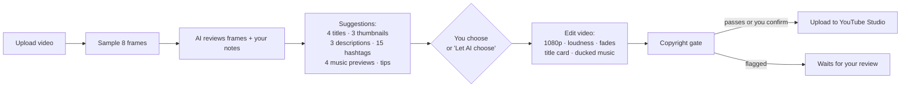

# AutoYT-manager: Project Overview

AutoYT-manager is a local web app that turns a raw video, or just an idea, into a finished YouTube
upload. An AI model (Gemini, ChatGPT or Claude) suggests the title, description, hashtags,
thumbnail and music. You choose, and the app edits the video and uploads it to YouTube Studio.

For setup steps, see [README.md](README.md).

---

## At a glance

| | |
|---|---|
| **Runs on** | Your own PC (Windows), in the browser at `http://127.0.0.1:8000` |
| **Input** | A video file (MP4, MOV, MKV, WEBM, AVI) or a text prompt |
| **Output** | An edited MP4 (1080p or 720p), a 1280×720 thumbnail, metadata, and an upload to YouTube |
| **AI providers** | Gemini `gemini-3.8-flash` (free tier), ChatGPT `gpt-6-astra`, Claude `claude-opus-5-5` |
| **Music** | Generated by the app's own code, with no samples, so there is nothing to claim |
| **Upload** | Official YouTube Data API v3, via OAuth sign-in to your own channel |
| **Stack** | Python 3.11+, FastAPI, Pillow, NumPy, ffmpeg (bundled), plain HTML/JS front end |

---

## Two ways to make a video

### 1. Upload a video, then choose from suggestions



### 2. Type a prompt

The AI writes a scene-by-scene script. The app renders a slide for each scene, records an offline
voice-over with Windows' built-in voices, adds generated music, and builds the video.

---

## What you can choose (video mode)

| Option | Suggestions | Editable |
|---|---|---|
| Title | 4 angles: curiosity, benefit, how-to, story | Yes |
| Thumbnail | 3 designs, each with a different frame, text and accent colour | Text |
| Description | 3 styles: short, story, detailed/SEO | Yes |
| Hashtags | 15, ranked; the top 8 are pre-selected | Tap to toggle |
| Tags and category | AI-suggested | Yes |
| Music | Calm, Upbeat, Lo-fi, Epic (20-second previews), or none | Pick one |
| Original sound | Keep it with music underneath, or replace it with music | Pick one |
| Settings | Title banner, visibility, made for kids, synthetic-media disclosure | Yes |

Each section starts with the AI's top pick, marked **AI pick**.

---

## Copyright safety

1. **Nothing the app adds can be claimed.** Music is synthesised from sine and triangle waves and
   noise. Thumbnails and slides use your footage, generated gradients and system fonts.
2. **Original wording.** The AI is told never to quote lyrics or scripts, and never to use other
   creators' or brands' names to attract views.
3. **AI review.** Every video is checked for TV, film or sports footage, music videos, other
   creators' clips, prominent logos, and kept audio that might contain songs.
4. **Upload gate.** A flagged video won't upload until you confirm you own the content.
5. **Private by default.** Uploads start as Private, so you can check YouTube Studio's own
   copyright result before publishing.

---

## Architecture

```
AutoYT-manager/
├── app.py              FastAPI server: HTTP API and file serving
├── static/index.html   Browser UI: upload, suggestion picker, job cards
└── autoyt/
    ├── ai.py           One prompt and JSON schema shared by Gemini, ChatGPT and Claude
    ├── pipeline.py     Job runner: suggest → choose → build → copyright gate → upload
    ├── editor.py       ffmpeg editing and slideshow assembly
    ├── music.py        Procedural music synthesiser (NumPy)
    ├── graphics.py     Thumbnails, title cards, slides (Pillow)
    ├── tts.py          Offline voice-over (pyttsx3 / Windows SAPI)
    ├── youtube.py      OAuth, resumable upload, thumbnail, processing status
    ├── media.py        ffmpeg helpers (binary bundled by imageio-ffmpeg)
    └── config.py       Settings loaded from .env
```

- **Jobs** run in background threads. Each job saves its state to `workspace/jobs/<id>/job.json`,
  so the UI survives a page refresh. If the app restarts mid-job, the job is marked as failed and
  can be retried.
- **AI calls** use each provider's official SDK and request structured JSON output, so every
  provider returns exactly the same fields.
- **The UI** polls the server every 2 seconds and updates one card at a time, so an open suggestion
  panel or a playing preview is never reset.

### API endpoints

| Method | Path | Purpose |
|---|---|---|
| `GET` | `/api/status` | AI providers configured, YouTube connection |
| `POST` | `/api/jobs/video` | Upload a video and start suggestions |
| `POST` | `/api/jobs/prompt` | Start a prompt-based video |
| `POST` | `/api/jobs/{id}/finalize` | Submit choices, then build (and upload) |
| `PATCH` | `/api/jobs/{id}` | Edit metadata or visibility after building |
| `POST` | `/api/jobs/{id}/upload` | Upload a finished video |
| `POST` | `/api/jobs/{id}/retry` | Retry a failed job |
| `POST` | `/api/youtube/connect` | Start Google sign-in |

---

## Configuration

All secrets live in a local `.env` file and Google's `client_secret.json`. Both are listed in
`.gitignore` and never committed. Use `.env.example` as the template:

```ini
GEMINI_API_KEY=<your-gemini-key>        # free tier: https://aistudio.google.com/apikey
OPENAI_API_KEY=<your-openai-key>        # paid
ANTHROPIC_API_KEY=<your-anthropic-key>  # paid

# Optional
AI_PROVIDER=gemini
AUTOYT_RESOLUTION=720                   # faster renders on slow PCs
```

| File | Contains | In git? |
|---|---|---|
| `.env` | AI API keys | No (ignored) |
| `client_secret.json` | Google OAuth client for YouTube | No (ignored) |
| `token.json` | Your YouTube sign-in token | No (ignored) |
| `workspace/` | Uploaded and rendered videos | No (ignored) |
| `.env.example` | Empty template with placeholders | Yes |

Never paste real keys into issues, commits or this file. If a key is ever exposed, revoke it in the
provider's console and create a new one.

---

## Limits to know

- **OpenAI has no free API tier.** ChatGPT models are billed per use. Gemini's free tier allows about
  10 requests per minute and may use your inputs to improve Google's products.
- **YouTube API projects start out private-only.** Videos uploaded through a new, unaudited Google
  Cloud project are locked to Private until Google approves an audit.
- **Custom thumbnails** need a phone-verified YouTube channel.
- **Rendering speed** depends on your CPU. A low-power laptop renders at about real time or slower at
  1080p. Set `AUTOYT_RESOLUTION=720` to roughly halve that.
- **No tool can guarantee zero copyright claims.** Always check YouTube Studio → Checks before
  making a video public.

---

## Quick start

```bat
git clone https://github.com/maddy1357/AutoYT-manager.git
cd AutoYT-manager
run.bat
```

Then add a key to `.env`, restart, click **Connect YouTube**, and upload your first video.
